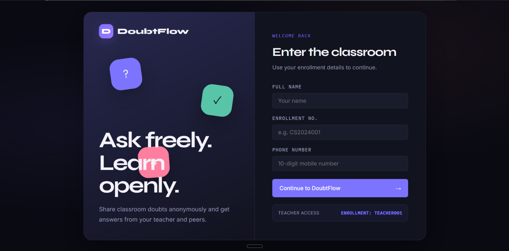
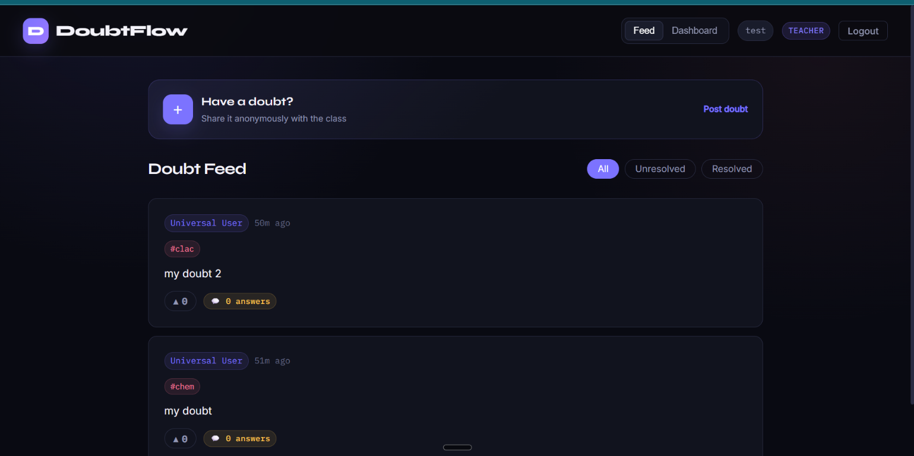
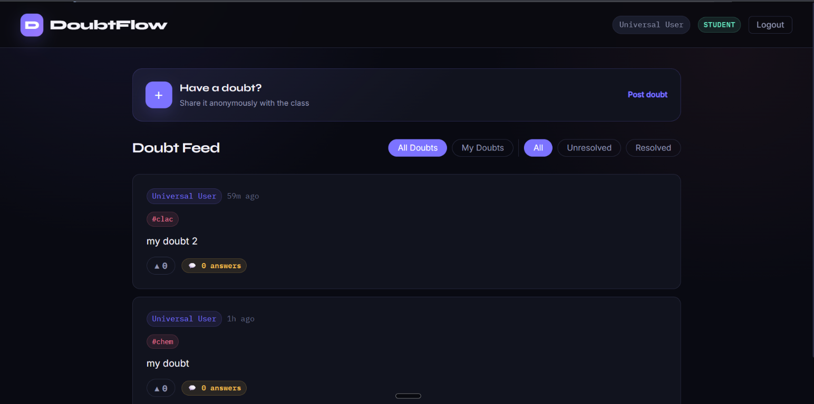

# DoubtFlow — Anonymous Classroom Doubt Platform

DoubtFlow is a full-stack classroom doubt platform where students can post doubts anonymously, browse all classroom questions, track their own doubts, vote on questions, and receive verified teacher answers.

## Screenshots

### Landing and Login

<p align="center">
  
</p>

### Teacher View

<p align="center">
  
</p>

### Student View

<p align="center">
  
</p>

---

## Folder Structure

```
DoubtFlow/
├── server/
│   ├── middleware/
│   │   └── auth.js
│   ├── models/
│   │   ├── User.js
│   │   ├── Doubt.js
│   │   ├── Answer.js
│   │   └── Report.js
│   ├── routes/
│   │   ├── auth.js
│   │   ├── doubts.js
│   │   ├── answers.js
│   │   └── reports.js
│   ├── uploads/          ← auto-created on first run
│   ├── server.js
│   ├── .env
│   └── package.json
└── client/
    ├── public/
    │   └── index.html
    ├── src/
    │   ├── api/
    │   │   └── axios.js
    │   ├── components/
    │   │   ├── Login.js
    │   │   ├── Feed.js
    │   │   ├── SubmitDoubt.js
    │   │   ├── DoubtDetail.js
    │   │   ├── Dashboard.js
    │   │   └── Toast.js
    │   ├── App.js
    │   ├── index.js
    │   └── index.css
    └── package.json
```

---

## Prerequisites

- Node.js v18+
- MongoDB running locally (or a MongoDB Atlas URI)

---

## Setup & Run

### 1. Clone / extract the project

```bash
cd doubt-platform
```

### 2. Configure MongoDB

For a local MongoDB instance:

```bash
mongod
```

Then set `MONGO_URI=mongodb://localhost:27017/doubtplatform` in `server/.env`.

For MongoDB Atlas, set `MONGO_URI` in `server/.env` to your Atlas connection string and include the database name, for example:

```text
MONGO_URI=mongodb+srv://<db_username>:<db_password>@<cluster-host>/doubtplatform
PORT=5000
```

Keep real credentials in `server/.env`. Do not commit `.env` files.

### 3. Backend setup

```bash
cd server
npm install
# Edit .env if you want a custom MONGO_URI or PORT
npm run dev        # uses nodemon for hot reload
# or: npm start
```

Server runs at **http://localhost:5000**

### 4. Seed the teacher account (run once)

```bash
curl -X POST http://localhost:5000/api/auth/seed-teacher
```

Teacher credentials:
- **Name:** Professor (or any)
- **Enrollment:** `TEACHER001`
- **Phone:** any

### 5. Frontend setup (new terminal)

```bash
cd client
npm install
npm start
```

Frontend runs at **http://localhost:3000**

The frontend uses `http://localhost:5000/api` for local development through `client/src/api/axios.js`.

---

## API Reference

### Auth
| Method | Endpoint | Description |
|--------|----------|-------------|
| POST | /api/auth/login | Login or register |
| POST | /api/auth/seed-teacher | Create teacher account |

### Doubts
| Method | Endpoint | Description |
|--------|----------|-------------|
| GET | /api/doubts?filter=all\|resolved\|unresolved&scope=all\|mine | Get doubts, optionally limited to the logged-in user's doubts |
| POST | /api/doubts | Submit a doubt (multipart) |
| POST | /api/doubts/:id/upvote | Toggle upvote |
| PATCH | /api/doubts/:id/resolve | Mark resolved (teacher) |
| DELETE | /api/doubts/:id | Soft delete (teacher) |

### Answers
| Method | Endpoint | Description |
|--------|----------|-------------|
| GET | /api/answers/:doubtId | Get answers for a doubt |
| POST | /api/answers/:doubtId | Post an answer |
| PATCH | /api/answers/:id/verify | Verify answer (teacher) |
| DELETE | /api/answers/:id | Delete answer (teacher) |

### Reports
| Method | Endpoint | Description |
|--------|----------|-------------|
| POST | /api/reports | Submit a report |
| GET | /api/reports | View all reports (teacher) |
| PATCH | /api/reports/:id | Update report status (teacher) |
| PATCH | /api/reports/block/:userId | Block a user (teacher) |

---

## Auth Headers

Every request (except login/seed) requires:
```
x-user-id: <MongoDB _id of the logged-in user>
```
This is set automatically by the Axios interceptor in the frontend.

---

## Features

- **DoubtFlow identity** — modern classroom-focused interface for students and teachers
- **Anonymous feed** — all students display as "Universal User"
- **Personal doubt section** — students can switch between All Doubts and My Doubts
- **Status filters** — All / Unresolved / Resolved
- **Teachers** see real names in the Dashboard
- **Upvote system** — toggle vote, no duplicates, sorted by votes
- **Image attachments** — up to 5MB per doubt
- **Tags** — comma-separated, shown as pills
- **Answer verification** — teachers mark best answers
- **Report system** — students report content; teachers review/dismiss
- **Block users** — teacher can flag accounts
